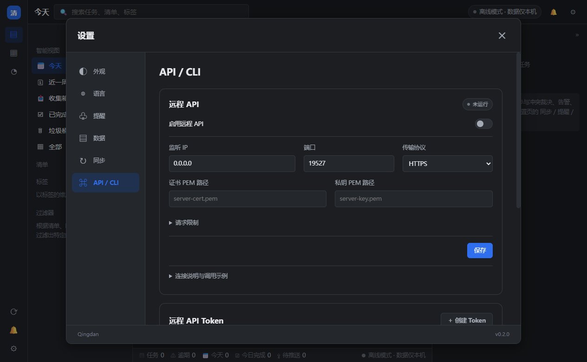
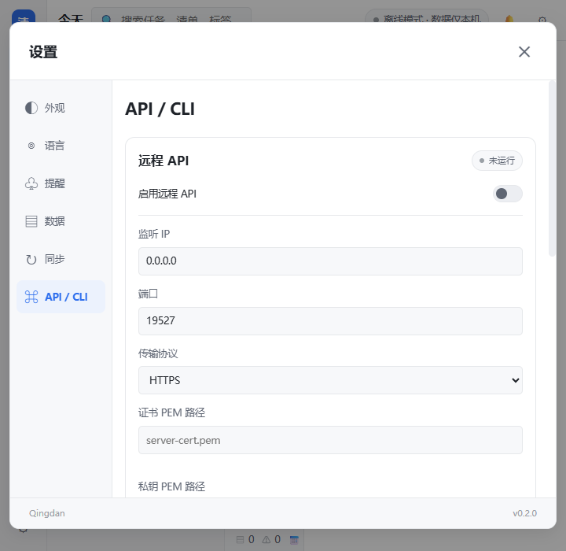

# 0.2.1 设置布局优化

- 设置采用左侧分类导航、右侧独立滚动内容，固定标题及底栏。正常宽度为 980px，随窗口自动收缩；切换分类保持尺寸一致。
- API 配置采用分组卡片，地址/端口/协议一行，证书和私钥一行；窄窗口切为单列。启用开关、运行状态、保存按钮层次清楚。
- CLI 示例和连接说明可折叠，减少首屏干扰；全部设置和调用功能保留。
- 统一间距、输入框、圆角、按钮及键盘焦点样式，适配深浅主题。极窄窗口改用顶部横向分类。
- 浏览器验证：1264×781、720×700 下六个页签均无内容横向溢出；480×700 下设置保持在视口内且分类和内容无横向溢出。协议切换隐藏 TLS 字段、Token 编辑正常；离开设置后新任务仍为 640px 弹窗，样式没有泄漏。
- 前端语法、本地化、CSS 守卫和目录缓存检查：41 项通过。
- 发布包：`dist/release-0.2.1/Qingdan`，41.03 MB。`清单-最新版.lnk` 已更新到该 EXE，继续使用现有数据目录，没有改写用户业务数据。
- 冻结包验收通过：111 个接口、CLI、本机运行时转交、前端资源与源码一致、周期任务、远程授权及真实 HTTPS。

预览：

