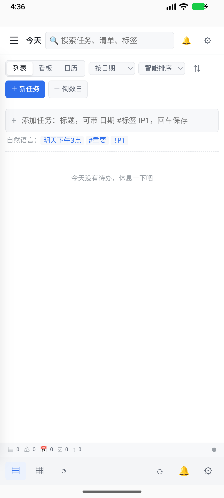

# 0.3.1 稳定性改造与验收

状态：第一阶段已完成，2026-11-12 合并 PR #1 并正式发布 0.3.1；整体后续优化目标仍在进行中。

## 实现与约束

- Android 的联网同步与本地提醒使用两个独立 WorkManager 任务；本地提醒不要求网络。
- Worker 检查原生桥 JSON 的业务结果；临时失败退避重试，凭据/配置/时钟问题暂停定时计划并提示处理。新凭据可恢复授权失败暂停的计划。
- 同步计划在执行前记录尝试，执行结束记录结果；中断后可恢复未完成尝试。同步期间保存或关闭计划，不被旧执行结果覆盖。
- Git 工作副本使用独立同步锁，网络等待不持有任务操作锁；合并/版本确认仍受操作锁保护。锁顺序为同步锁再操作锁，普通任务操作不等待同步锁。
- 凭据和仓库切换也使用同步锁，避免执行到一半更换远端；它们等待时不持有任务操作锁。
- 已推送版本仅在当前任务版本与其相同时才清除 dirty；并发产生的新编辑保留待推送。失败推送不推进成功基线。
- HTTP 的同步业务从 ASGI 事件循环移到工作线程；远程权限在上传完成及普通变更锁就绪后重新校验。
- Android 原生桥初始化保留串行保护，业务请求允许并发；页面请求与生命周期调度分开，避免慢网络挡住所有请求。
- 前后台切换创建独立的调度停止信号，避免重启调度时恢复已停止的旧循环。
- 新增 `sync.progress` 只读接口，记录检查/拉取/合并/推送/完成/失败与数量；设置页每两秒刷新状态，保留表单草稿及焦点，失败不会提示成功。
- CI 在仪器测试清理应用后重新安装并打开已构建的测试 APK，截取原生页面；记录截图来源，避免把缺失截图当成已验证。

## 当前证据

- 首批 Worker 拆分及业务结果分类提交 `4b91596` 的 [CI](https://github.com/ziyueguyi/Qingdan/actions/runs/43146788571) 已通过 Windows 全量回归、APK 构建及 Android 模拟器测试。
- 并发回归覆盖：首次拉取期间新建任务、推送期间编辑后继续保持 dirty、第二轮推送新版本、失败推送保持成功基线、重复同步快速返回忙状态、同步中读取进度、退出登录排队期间仍可编辑、同一 ASGI 事件循环处理并发 HTTP 请求。
- 定时回归覆盖：网络退避、授权暂停/重新登录恢复、保存/关闭计划与运行中任务并发、中断尝试恢复。
- 浏览器受控响应验证：状态从拉取切换为完成时，输入框中的 31 分钟草稿及输入焦点保持。此处只验证界面刷新，不冒充真实 Gitee 联网同步证据；真实 Git 传输由隔离裸仓库测试验证。
- 最终 PR [CI 43155394920](https://github.com/ziyueguyi/Qingdan/actions/runs/43155394920)：Windows 774 项通过；Android 6 项通过，无失败或跳过，含原生桥并发、断开网络后的实际通知和系统栏坐标断言。冻结 EXE 的 CLI、HTTP/HTTPS、远程 Token 权限和打包静态页面一致性检查通过，文件夹 41.66 MB，满足 42 MB 门禁。
- 正式 main [发布流水线 43156965051](https://github.com/ziyueguyi/Qingdan/actions/runs/43156965051) 的 Windows、Android、Release 三个作业全部通过；发布源码为 `14d640348711fb1898aa08f4f10a1f80de652f81`。
- [Releases 页面](https://github.com/ziyueguyi/Qingdan/releases) 已包含 Windows x64 ZIP 和 Android arm64 APK，以及各自 SHA-256 校验文件。正式发布文件已下载到本地并逐项与 GitHub 记录的 SHA-256 比对；Windows CLI 返回 0.3.1。项目根目录最新版快捷方式已更新，保留原用户数据目录参数。

首轮完整 CI `43153959496` 已通过：Windows 774 项、Android 6 项且均无跳过，含断网实际通知和原生桥并发。实际截图另发现系统栏与网页内容重叠，已改为在 WebView 父容器处理系统栏/刘海/键盘 Insets，并增加屏幕坐标断言；此修复已由最终 PR CI 的截图和运行断言复验后发布。

截图来自最终 PR CI 的原生应用重新打开流程（仪器测试清理后重新安装并启动），使用全新隔离数据；不含实际用户任务。

## 保留的限制

Android 的周期后台任务仍受系统调度、省电及最低 15 分钟间隔约束；本次分离联网约束不等于精确闹钟。模拟器测试不替代真机验收。第二、三阶段继续按目标计划推进。

## 发布文件摘要

- Windows ZIP SHA-256：`9f78dfda4db3be46ea5923649d4ecac26421c2c11c2d3837930c95e633bc2c3b`。
- Android APK SHA-256：`455ae51e4b0e1adb1c269de304b333be90efaf8424d4ef28bf736c04a7dd057a`。
