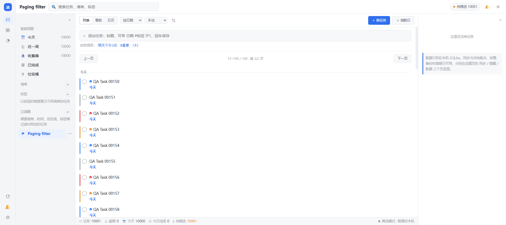
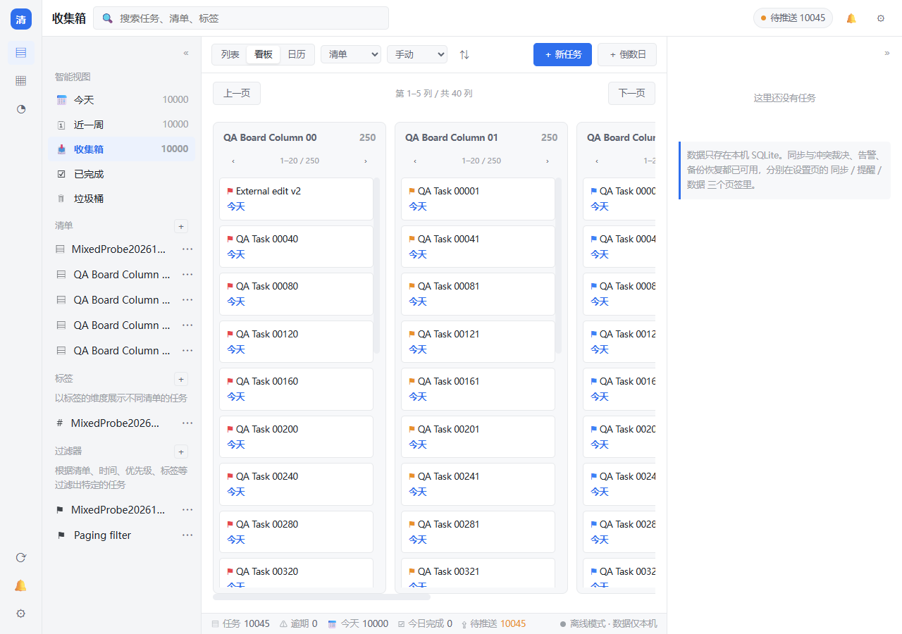

# 0.4.0 规则与性能设计（开发中）

此文档描述第二阶段约束，不代表下列功能已发布。当前发布版为 0.3.1。

## 工作日日历

`core/workdays.py` 已建立不依赖网络的中国大陆工作日日历快照
`CN-20261105`，包含 2026、2027 年政府已公布的安排。放假日期、调休上班日期、
通知文号、发布日期和政府来源一同保存；采用星期一至星期五的通常工作周，
并按通知覆盖。此日历不代表单位排班、地方特殊假期或个人带薪休假。

快照不可变。未来数据更新添加新快照 ID，不修改旧 ID 的日期含义。
重复规则必须保存使用的快照 ID，使相同任务在不同客户端使用相同算法和数据。
客户端不认识快照或缺少所需年份时明确提示，禁止静默按普通周末推算。

来源：

- [2026 年通知（北京市政府转载）](https://www.beijing.gov.cn/cs/gncs/zcwj/202603/t20260327_4568275.html)
- [2027 年通知（国家林草局转载）](https://www.forestry.gov.cn/lyj/1/szxx/20261105/695102.html)

## 待接入的重复规则

在既有“规则”独立小弹窗增加工作日处理选项；主任务表单保持紧凑。
计划采用显式的 RRULE 扩展键保存跳过/顺延及日历快照，旧客户端拒绝不支持的键，
避免忽略新约束后错误推进。接入前必须覆盖以下语义：

- 不处理、跳过非工作日、顺延至下一个工作日；全天属性与原有时刻不改变。
- 首次到期日也应用规则，另存原始 repeat_start 作为周期锚点。
- COUNT 计算实际不同执行日期，顺延碰撞去重；UNTIL 限制实际到期日。
- 每日规则可落在调休上班的周末；每周 BYDAY 仍先按所选星期产生候选，
  不擅自增加未选星期。非工作日处理只作用于这些候选。
- 月末、跨年、连假和不同日历版本均有确定结果；未知年份不得被当作规则自然结束。
- 预览允许显示已知部分并明确指出缺失年份；推进遇到缺失年份须保留当前任务和待办状态，
  不能先记完成历史或丢失待推送编辑。

开发分支已接入 UI/API：`X-QD-WORKDAY=SKIP|NEXT` 与 `X-QD-CALENDAR=CN-20261105` 必须成对指定；“规则”小弹窗可选择、预览和保存，详情显示规则与缺失年份。首次日期、次数去重、原始周期锚点、提醒偏移、缺失年份阻止完成以及未知快照保护均有回归测试。普通编辑重传未改变的到期日和规则时不重新下锚。

工作日扩展沿用既有 Item 与同步格式；旧版本不能计算新工作日规则，使用这些任务的各客户端须先升级，不能在旧版继续推进。既有不带扩展的规则保持原行为。

本地验证：规则/服务/日历基础 95 项通过；随后包含重复任务生命周期、日历视图与界面检查的 126 项通过（集合有重叠，不相加作为全量测试数）。隔离浏览器实测选 2026-02-15 09:30、顺延、COUNT=3：预览及实际保存首次日期为 02-24 09:30，锚点保留 02-15，后续为 02-25、02-26。工作日规则提交 `12416b7` 的 [完整 CI](https://github.com/ziyueguyi/Qingdan/actions/runs/43354679160) 已通过 Windows 和 Android 作业；上一轮接口元数据中文显示文本问题已修正，通知文号和警告改为机器标识。后续分页改造仍须重新进行最终全量 CI，本阶段尚未发布。

## 分页与性能

分页应在 SQLite 查询阶段执行，不能先把全部任务解码再切片。
视图查询、分组、计数、统计和启动加载均需检查；清单名称只查询当前结果引用的 ID。
用既有视图行为作为结果基准，比较筛选、排序、分组、搜索和日历的完整性。
前端保存当前页及相邻预取页，避免无限增加 DOM。日历密集日期通过更多入口分页查看，
不得静默截断任务。

用隔离的万条任务数据记录首次打开、翻页、筛选、接口响应大小及渲染数量。
索引只使用旧客户端也可理解的 SQLite 内建能力，避免新建依赖自定义 SQL 函数的
持久化索引导致旧版无法打开数据库。

### SQL 分页后端验收（2026-11-13）

`view.query`、`filter.tasks`、`search.query` 已支持 `limit/offset`、完整匹配总数、
`has_more` 与 `change_token`。分组和清单名称仅针对当前页。为兼容既有 API，
内置视图/过滤器的默认 `limit=0` 仍表示全量；界面接入时必须显式传入页大小。
搜索默认上限 200，新增分页后 total 表示全部匹配数量。

`view.counts` 和 `stats.today` 改为 SQL 聚合，不解码整批 Item。查询日期使用连接本地
函数保留原来的本地时区语义，单次请求的日期缓存最多 512 项；数据库没有依赖自定义
函数的新持久化索引。分页另增本地变更计数表和原生 SQLite 触发器，既有 Item 与同步格式不变。

测试以既有纯函数为对照，覆盖所有视图、排序、正反序、完成项选项、页偏移、分组、
过滤条件及 Unicode 搜索；万条数据断言取 50 条只解码 50 个 Item，统计计数不解码 Item。
相关分页/视图/过滤器/界面契约 77 项通过，聚合优化后分页和视图接口 28 项再次通过。

可重复命令：

```powershell
python scripts/benchmark_task_views.py --output buildtmp/task-views-baseline.json
```

完整结果见 [后端万条基准](task-views-10000-backend.json)。本机 Windows / Python 3.14.5，
五轮中位数：原全量读取排序 106.8 ms，首页 50 条 17.6 ms，中间页 38.9 ms，
侧栏全局计数 91.2 ms，统计 65.2 ms。首页 Python 峰值分配约 131 KB，
原全量读取排序约 23.2 MB；首页 JSON 约 37.8 KB。

这些基准结果仅测量后端查询。列表界面的独立验证见下文；看板分页见下文；日历密集任务入口和原生 Android 性能仍待完成。

### 前端分页与共享版本验证（2026-11-13）

内置任务列表、清单/标签筛选、自定义过滤器和搜索均显式请求 50 条；页面只渲染当前页，
缓存最多三页，并提前请求相邻页。可按按钮翻页，向下滚到底部会替换为下一页。
快速输入草稿在翻页重绘时保留，有草稿或正在输入时不触发自动翻页。

原 `PRAGMA data_version + total_changes` 属于连接局部计数，无法跨 HTTP 工作线程比较。
新增 `change_revision` 本地表和原生 SQLite 触发器，旧客户端的普通 SQL 写入也会更新计数。
`app.health.change_token` 仍为两项整数，分别反映 Item 和配置变化；新增 `task_token`
作为分页版本，配置/进度变化不使任务缓存失效。页结果的 `change_token` 为相同的 Item 版本。
计数、当前行、过滤器定义和清单名称在同一短读取快照内取得，不提前提交或回滚调用方事务。
翻页先检查版本；发现任务数据变化会丢弃旧缓存，从第一页重新查询，避免拼接新旧结果。

搜索 `total` 现在表示所有匹配项，`items` 仅表示当前页；原来以 total 断言页大小的测试
已改为分别断言匹配总数与实际返回数量。非任务搜索结果显示名称和类型，跳转对应清单、
标签、过滤器或备注所属任务，不提供任务完成控件或任务右键菜单。

验证记录见 [万条任务浏览器验收](task-paging-browser-10000.json)：

- 万条任务中当前页始终 50 行；按钮连续翻页的本机样本为 26–36.1 ms，行 ID 连续且不重复。
- 首屏请求当前页及下一页；缓存复用和三页上限、重复请求合并、失效响应与预取失败重试由 Node 行为测试覆盖。
- 外部 API 编辑后检测到共享版本变化，重取第一页并显示新标题；快速输入草稿保留，清空后恢复自动翻页。
- 搜索 99 条按 50/49 条显示；自定义日期分组过滤器 100 条按 50/50 条显示。
- 清单、标签、过滤器和备注的混合搜索返回 4 项，名称及跳转目标正确，点击空清单可进入 0 条结果页面。
- 390 像素宽的 Android 专用样式在浏览器 HTTP 环境预览：页面无横向溢出，仍只渲染 50 行。
  此预览未使用原生桥；移动视口截图协议超时，仅记录 DOM/视口测量，不声称取得了手机截图。



本地完整回归基线 814 项通过、零跳过；随后快照边界、分页、视图和界面契约的 83 项相关检查通过。
补充回归覆盖跨连接/线程的共享版本、旧数据库迁移、旧客户端直接 SQL 写入、事务回滚、
外部写入与分页读取交错、过滤器定义及清单名称的一致快照。最终提交仍须通过完整 CI。

### 看板列与卡片分页（2026-11-13）

看板支持状态、清单、优先级列分组，并尊重内置视图、标签、过滤器及排序。
界面每组显示 5 列、每列 20 张卡片，列标题保留完整卡片数量。各列可以按钮翻页，
卡片滚到底部自动替换到下一页；列组也有前后翻页入口。相邻列组和卡片页提前查询。
列组缓存最多三页，活动卡片分页器仅保留当前五列，每个分页器最多三页。
单列翻页保留横向位置及其他列的滚动位置，当前列新页回到顶部。
看板启动时也查询全局统计，底部计数不会因未先进入列表而显示缺失。

`view.board` 新增 `limit/offset/column` 及 `columns_limit/columns_offset`。
不带 column 时返回当前列组及完整的 board_total/columns_total；带 column 时返回指定列的
卡片页，total 为该列匹配数，board_total 为 null，列组元数据表示本次单列，不再重复统计全看板。
为兼容既有 API，默认 limit=0、columns_limit=0 仍允许全量；界面明确使用 20/5。
所有计数、筛选定义、名称与卡片均来自同一读取快照。

看板相关本地 102 项检查通过，覆盖与原纯函数逐列/逐卡片结果对照、多列完整遍历、
万条任务只解码当前 100 张卡片、筛选与排序、错误参数、预取、缓存上限、过期列组响应、
查询切换及刷新与卡片翻页并发。

[后端看板基准](task-views-10000-board.json) 在万条任务、20 个分组下：首批五列中位 125.5 ms，
Python 峰值分配约 198 KB；单列第二页中位 37.8 ms，峰值约 53 KB。
[浏览器验收](board-paging-browser-10000.json) 使用万条任务、40 列，每列 250 张：当前 DOM 为
5 列/100 张卡片，单列翻页样本 54.1 ms，列组切换 37.9 ms，位置保留及外部编辑后的缓存失效通过。
这些样本不代表原生 Android 性能。



### CI 与模拟器离线隔离

提交 `1462456` 的 [CI](https://github.com/ziyueguyi/Qingdan/actions/runs/43362514806)
Windows 测试报告确认 817 项、零失败/错误/跳过，Windows 构建作业通过。
Android 报告为 6 项、1 项失败、零跳过：离线提醒测试已收到通知，但最后的严格断网断言发现
模拟器重新出现活动网络 101。本轮不能标记为严格离线验收通过。

测试已补充飞行模式隔离，保留起止均无活动网络的断言，并核对飞行模式保持启用；
结束后恢复原先的飞行模式、Wi-Fi 和移动数据状态。命令按
[AOSP ConnectivityService 的 shell 接口](https://android.googlesource.com/platform/packages/modules/Connectivity/+/refs/heads/main/service/src/com/android/server/ConnectivityService.java)
实现，仅在一次性模拟器运行，不放宽失败条件，也不替代真机验收。

提交 `32f990c` 的 [CI](https://github.com/ziyueguyi/Qingdan/actions/runs/43368462413)
Windows 与 Android 作业均通过。Android 17 模拟器的
`connectedEmulatorDebugAndroidTest` 成功，包含上述严格离线提醒测试；
签名 APK 已构建，证书 SHA-256 与既有固定签名一致。
这是开发分支验证，本轮未发布新版本；日历分页与通知动作仍须继续完成。
用户于 2026-11-13 再次确认暂时没有可用真机，锁屏、省电、重启及实际覆盖升级的
真机验收保持待完成，不以模拟器构建成功替代。

## 通知与交付

通知动作需覆盖冷启动定位、已删除任务、完成重复任务和稍后提醒；重复点击具有明确结果。
Windows 与 Android 的权限及后台限制分别记录。第二阶段须完成集成测试、全量回归、
Windows EXE 与同一固定签名的 Android APK 构建后再更新版本和发布。
