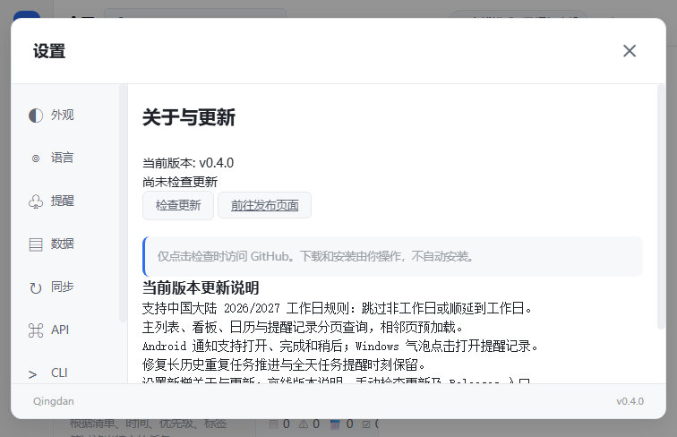

# 发布体验与设备验收

## 设置中的关于与更新

- 当前版本由运行中程序提供；本版本说明作为包资源随 Windows / Android 分发，离线可读，支持中文和英文。
- 打开页面不联网。仅点击“检查更新”时，以 POST 调用本机 `app.release_info(check=true, lang=...)`；跨站页面和远程 API 均不能触发此请求。
- 请求固定 GitHub 仓库的 latest Release，使用 TLS 验证并支持标准代理/CA 环境，不附带 Gitee/API Token，不跟随重定向；连接/读取超时、12 秒总 deadline、限流和异常响应均返回机器状态，保留离线说明。
- 响应最多 1 MiB，只接受无前导零的稳定三段式版本号，按数值比较；最新说明最多 20000 字符，以转义文本展示。说明内链接或 HTML 不执行。
- 网络期间不持有任务操作锁。界面关闭或换页后，结果不重新打开弹窗。
- Releases 按钮固定指向仓库发布页面；Windows 由 pywebview 交给系统浏览器，Android 使用仅允许该固定 HTTPS 地址的原生 Intent。不自动下载、安装、启动安装器或删除旧数据。

## Windows 首次启动

按 [微软 WebView2 分发说明](https://learn.microsoft.com/microsoft-edge/webview2/concepts/distribution#detect-if-a-webview2-runtime-is-already-installed) 检查当前用户及机器 32 位注册表视图的正式 Runtime `pv`，不以 Edge 浏览器存在替代 Runtime 存在。拒绝读取时为 unknown，允许实际启动尝试，不误判缺失。

确认缺失时，原生中英双语对话框引导到微软下载页面；在线可用 Evergreen Bootstrapper，离线可用匹配架构的 Standalone Installer。只有用户选择打开页面才调用浏览器，不自动安装。本次在数据库、提醒及同步启动前退出，`http.json` 记录 `WEBVIEW2_MISSING`，释放单实例锁。

## 当前验证（2026-11-19）

- Windows 全量回归 **966 项通过，0 失败、0 错误、0 跳过**。定向发布/预检/接口契约 74 项通过；覆盖 POST 跨站拒绝、全权限远程 Token 的 LOCAL_ONLY、慢速流总 deadline、恶意版本号及 WebView2 加载失败。
- 本机正式 Runtime 检测得到 installed（157.0.4341.60）。模拟注册表覆盖按用户/机器安装、空/零/损坏/超长版本、缺失及访问拒绝；确认缺失路径未初始化数据库并释放锁。加载失败路径写入 `WEBVIEW2_START_FAILED`，清理后显示原生引导。尚无真实“无 WebView2”Windows VM 证据。
- Python wheel 核查含 `qingdan/core/release-notes.json`。最终 Windows 冻结目录 **40.00 MB**，通过 42 MB 门禁；119 个功能的 CLI、HTTP/HTTPS、远程权限、静态资源一致性通过，额外断言包内离线说明、跨站拒绝及远程本机隔离。
- 真实本地 HTTP + Edge：离线当前说明显示；点击检查成功读取 GitHub latest Release v0.3.1，当前 v0.4.0 正确判定为不落后，按钮恢复且说明保留。模拟响应还覆盖新版本、HTML 纯文本与失败分类。下图是本地浏览器证据，不是原生窗口或 Android 截图。

- Android 生成源码包含资源；原生测试已增加关于页、Releases 固定地址与原生外链方法断言。新增恢复脚本要求真实 v0.3.1 基线、当前包覆盖安装、SQLite 行核对、锁屏省电通知、真实重启及重启后 JobScheduler，缺失或跳过证据均失败。**这些新增 Android 检查尚待 CI 运行，不能提前标记通过。**
- 第三阶段改动尚未提交/发布；正式 EXE、固定签名 APK 与 Releases 状态以 CI 和发布页为准。

## 设备边界与后续验收

用户确认暂无安卓真机；真机锁屏、省电厂商差异、重启、断网恢复和固定签名覆盖升级均待实际设备。模拟器证据单独保留，不代替真机。

Android 17 模拟器已有严格断网提醒/稍后、冷启动、万条主视图及截图证据。`scripts/verify_android_recovery.sh` 现已加入可重复的 v0.3.1 → 当前版覆盖升级、重启恢复、省电/锁屏及真实 PNG 流程，且普通套件中的四个定向阶段只通过该脚本运行；实际结果仍待 CI 留存。该脚本使用同一 CI debug 签名，不能替代 arm64 正式固定签名或真机验收；固定签名校验本身也不能证明升级后数据保留或提醒恢复。

2026-11-23 复查：PR #4 在 `prepareBaseline` 阶段连续 7 次失败，Windows 作业均通过。根因是测试假设本地提醒会注册 `SystemAlarmService` 闹钟，但 WorkManager 2.10.1 在 API 23+ 只创建 SystemJobScheduler（源码 `Schedulers.createBestAvailableBackgroundScheduler`），闹钟从未存在；此外基线证据中 `boot_id` 为空，Android 17 模拟器镜像不导出 `ro.boot.boot_id`。现已改为：两个周期 Worker 都以 SystemIdInfo 作业号绑定到 `dumpsys jobscheduler` 中本包 `SystemJobService` 的作业块（轮询到首跑被重新调度后再核对），重启标识依次读取 `/proc/sys/kernel/random/boot_id`、`ro.boot.boot_id`、`settings global boot_count`。修正后尚待 CI 实际运行，未标记通过。
