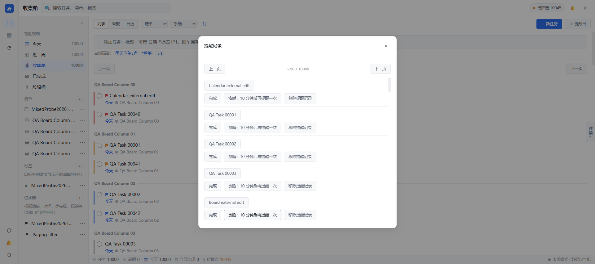
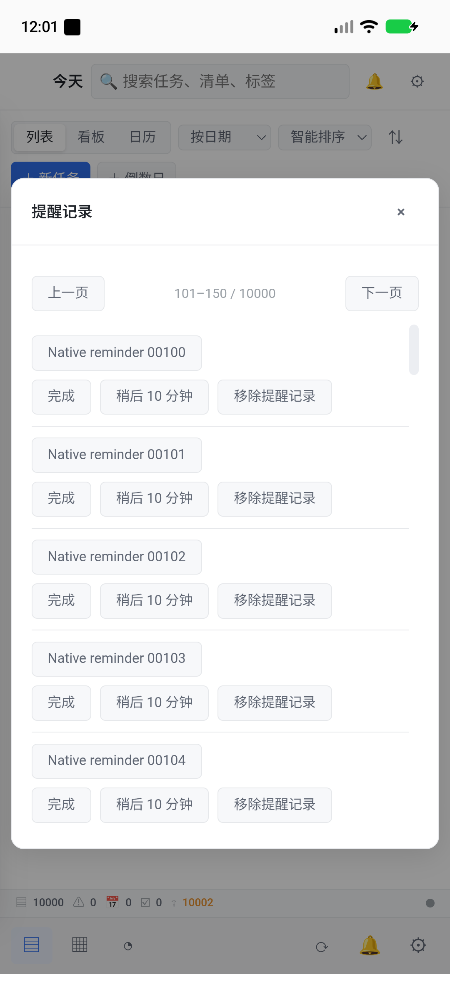

# 通知操作设计与验收（0.4.0 开发中）

## 核心语义

新增本地功能 `alert.notification_action`，HTTP 为
`POST /api/v1/alert/notification-action`，CLI 由注册表派生。
支持 open、complete、snooze（默认 10 分钟，上限 1440 分钟）。
它是本地操作回调，远程监听器明确返回 LOCAL_ONLY，即使 Token 拥有全部权限也不能调用。
既有 task.complete/task.snooze 及其远程 update 授权保持原样。

提醒消息携带发送时的 Item 修订号 ms/seq/dev。修改动作必须给出完整修订号，
在同一个 operation_lock 与 SQLite BEGIN IMMEDIATE 写事务内比较并调用既有服务；
内部服务的 commit 延迟至整个动作结束，跨本地 CLI 进程也不能插入一次新的推进。
事务异常回滚，已有调用方事务使用保存点保留；不通过嵌套 registry.call 清掉撤销前像。
完成后仍使用既有重复推进、历史、提醒重建、dirty 标记及同步机制。
旧通知遇到已编辑/已同步/已推进的版本，返回 stale；不完成下一次，不推迟新一次的提醒。
并发重复点击最多修改一次。open 总是打开当前记录，不用旧快照覆盖内容。
删除/彻底不存在返回 gone，已完成/取消返回 inactive，倒数日只支持 open。

返回状态为机器标识，不含后端展示文案。通知快照只属平台派发数据，未改变共享 Item 或同步格式。
操作成功可撤销；拒绝旧快照不新增撤销记录。工作日日历不全时仍由既有服务拒绝推进，不吞掉业务错误。

稍后提醒重建始终使用已保存的 snoozed_until，即使重启时已到触发时间，
也不会退回更早的 due_at。显式修改日期、重复规则或提醒时间会清理旧稍后提醒，
自动推进继续清理当前次数的 snooze。已完成/取消任务不会再组装待发送消息。

## Android 接入

单条任务独立通知，携带任务 ID、版本和触发时刻。内容点击直接启动 MainActivity，
在页面完成启动后消费导航数据；运行中的 Activity 通过 onNewIntent 接收。
启动数据无论带什么 action，前端只执行 open。删除后的目标明确显示提示；
已有弹窗时先确认是否放弃未保存内容。倒数日使用原有编辑弹窗。

任务通知提供“完成”和“稍后 10 分钟”。显式、不可变 PendingIntent 的身份包含任务、
触发时刻、修订和动作，避免不同通知复用并覆盖参数。非导出的 Receiver 只接收两种固定动作，
通过 goAsync 等待后台作业持久入队后结束。NotificationActionWorker 无联网约束，
应用未打开时也可初始化本地运行时执行；不从 Receiver/Worker 弹出 Activity。
这是按 [Android 通知动作及 PendingIntent 约束](https://developer.android.com/develop/ui/compose/notifications/create-notification)
实现，避免通知中转启动 Activity 的限制。

成功、目标消失或已完成后移除对应通知。旧快照或业务失败保留可点击的结果提示；
先核对当前系统通知的快照，不能取消或覆盖同一任务较新的通知。
Android 7/8 的通知构造分支仍保留，最低支持版本未提高，固定签名身份未变。

## 批量提醒与 Windows 入口

notification_item 保存设备本地提醒目标，一条任务最多保留一条最新快照；不写进同步 Item。
记录使用独立修订计数，和 Item 修订一起保护分页一致性。相同目标/版本/触发时刻重试不更新计数。
alert.notification_list 是本地 API/CLI 功能，远程 Token 无法调用；无全量模式，limit=0 也只返回 50 条。
界面每页 50 条、相邻预取、三页缓存；滚动替换当前页，关闭/改开弹窗使旧响应失效。
显示已变化、已完成/取消、已删除状态；完成/稍后仍调用受版本保护的动作，移除记录不删除任务。

Android 同一批多条消息只发一条汇总通知，点击打开完整分页记录。
独立通知数量限制为 20，汇总通知使用固定身份；被替换的系统通知仍在本地记录中可查看和操作。
完成/稍后成功同时确认匹配版本的记录并更新汇总数量，旧记录不能确认较新版本。

Windows 订阅 pystray 原本未处理的 NIN_BALLOONUSERCLICK，通过最小 pywebview 接口传递导航。
接口只消费一次 inbox=true，不接受执行动作或任意功能名。对应系统消息的含义见
[Microsoft Shell_NotifyIcon 文档](https://learn.microsoft.com/en-us/windows/win32/api/shellapi/nf-shellapi-shell_notifyicona)。
气泡事件没有逐消息标识，因此统一打开持久提醒记录，不猜测 Windows 当时展示的是哪一条；
用户从条目定位对应任务或执行完成/稍后。该差异保留在交付说明中，不宣称气泡支持系统内动作按钮。

验证记录见 [提醒分页与原生桥证据](notification-inbox-evidence.json)。

## 当前证据与待完成项

最新原生证据：提交 `b7f554c` 的 [CI](https://github.com/ziyueguyi/Qingdan/actions/runs/43421156780) 中 Windows 与 Android 作业全部通过。Android 17 模拟器 8 项检查零失败、零错误、零跳过，已确认通知完成/旧版本拒绝、启动定位、严格断网稍后，以及万条提醒分页、主列表和看板。下文旧提交失败记录保留为修复背景，已由此结果取代；最后的规则与时间修复仍需最终候选提交 CI。

0.4.0 最终候选本地回归：931 项通过，零失败、零错误、零跳过，用时 469.681 秒（`040-release-final-results.xml`）。包含长历史推进、跨时区工作日锚点、全天提醒保留时间和托盘拒绝发送检查；候选提交的双平台构建尚待 CI。

截图来自该提交的真实原生仪器测试，版本仍为开发分支的 0.3.1，不是最终 0.4.0 发布包或真机证据。

- 日历前置提交 fff35be 的 [Windows / Android CI](https://github.com/ziyueguyi/Qingdan/actions/runs/43372648650) 均通过。
- 核心回调、既有提醒与 HTTP 全功能契约检查集 88 项通过；后续提醒重排及界面相关检查集 72 项通过。集合重叠，不相加作为全量数。
- 浏览器 HTTP 模拟 Android 桥验证：启动即定位 T00000003，详情出现且状态仍为 todo；启动数据带 complete 也不发生修改。此为界面逻辑验证，不是 Android 原生证据。
- 提交 0453895 的 [CI](https://github.com/ziyueguyi/Qingdan/actions/runs/43376473147)：Windows 作业通过；Android 7 项中 6 项通过、1 项失败、零跳过。严格断网提醒及真实稍后动作已通过。
- AndroidNotificationActionsTest 首次推进及第二次 stale 已执行，失败在等待两条历史 WorkInfo：WorkManager 替换完成的唯一作业链后只返回新的 stale 作业。测试改为等待不同 UUID 的新作业并检查 stale，保留实际推进一次及新通知不被覆盖的断言，待新 CI 确认后续启动定位。
- 本轮本地最终完整回归 883 项通过，485.19 秒，零失败；5 条警告来自既有 FastAPI 测试客户端与 Pillow 弃用提示。Android 原生代码仍待新提交 CI 构建及仪器测试，未据代码存在标记原生验收通过。
- 本轮新增分页记录等改动的完整回归 891 项通过（394.42 秒）；增加跨连接写事务保护后，相关 36 项检查及最终全量 895 项通过（589.92 秒）。另外复核了预先建立连接的外部写入竞态。集合有重叠，不能相加。
- 独立托盘的合成原生点击事件通过；真实隐藏 Edge WebView2 + pywebview 桥在万条数据下显示 50 条、翻到 51–100 并打开对应 WIN00050 任务。普通沙箱初始化超时未计通过，允许本机图形进程的同一隔离测试通过。未进行物理鼠标点击或系统气泡显示截图。
- 浏览器实际后端检查：万条记录 DOM 始终 50 条，第二页及滚动到第三页后位置归零；查询样本约 7–12 ms。旧快照拒绝完成，完成、稍后和移除后的数量分别变化；稍后不改到期日。
- AndroidNotificationInboxTest 已增加真实适配器万条消息汇总、最多 21 条平台通知、分页/预取入口、列表 50 条及看板最多 100 张卡片，并将测试中截图写到 shell 持有的 Download 文件以跨 AGP 卸载留存。这些新增原生检查尚待 CI，不提前标记通过。
- 通知阶段继续保留草稿；工作日规则推进/预览的历史边界还需与日历窗口算法复核，阶段完成前不发布。
- 用户暂无可用安卓真机，锁屏、厂商省电、重启和实际覆盖升级仍待真机证据。
